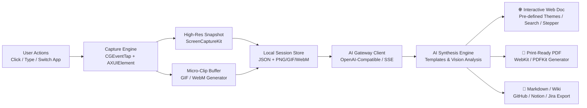
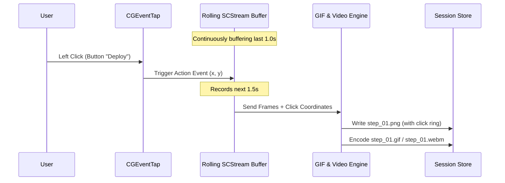
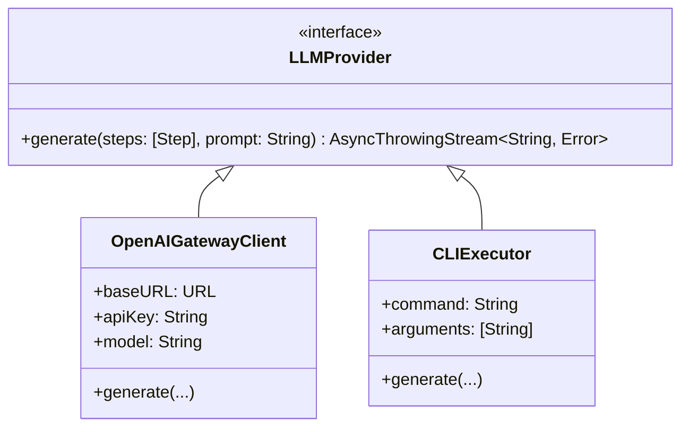
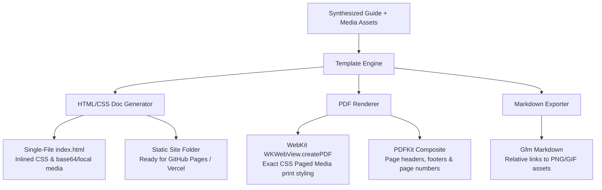

# ⚡️ StepIt — Architecture & Implementation Plan

> **Effortless step-by-step workflow capture & AI synthesis for macOS.**  
> Native Swift. Privacy-first. Multi-provider AI Gateway. Static & Animated (GIF/WebM) capture.  
> **1-Click Publishing to Interactive Web Documentation, Print-Ready PDFs, and Markdown.**

---

## 🎯 Vision & Philosophy

- **Zero Friction**: Start recording with one shortcut (`⌥ ␣` or menu bar click), perform your actions, press stop.
- **Ultra Minimal UI**: A floating glass pill HUD or menu bar extra that stays completely out of your way.
- **Intelligent Capture (Dual-Mode)**:
  - **Static Snapshots**: Pinpoint screenshots with click coordinates, UI element role/title via macOS Accessibility APIs, and visual highlight markers.
  - **Animated Micro-Clips (GIF & WebM)**: 1.5s–3s rolling animated clips capturing cursor motion, hover states, dropdown reveals, and UI transitions.
- **Universal AI Gateway**: Seamlessly routes captured steps to Cloud Gateways (OpenRouter, Portkey, LiteLLM, Cloudflare AI Gateway) or Local LLMs (Ollama, LM Studio) and local CLIs via an OpenAI-compatible standard.
- **Multi-Format Publishing Engine**: Instantly export synthesized guides as:
  - 🌐 **Interactive Web Documentation**: Beautiful self-contained static site with pre-defined modern themes, stepper navigation, and playable GIF/WebM embeds.
  - 📄 **Print-Ready PDF Guides**: Executive SOPs and documentation formatted with headers, page numbering, callouts, and high-res images.
  - 📝 **Markdown & Raw Assets**: Ready for GitHub READMEs, Notion, Confluence, or internal wikis.



---

## 🧭 User Experience Flow

| Step | Action | Description |
| :--- | :--- | :--- |
| **1. Start** | `⌥ ␣` (Option + Space) | Floating pill appears in dynamic recording mode (shows timer & step counter). |
| **2. Act** | User clicks / types | StepIt captures action metadata, screenshot, and rolling animated micro-GIF / WebM snippet. |
| **3. Finish** | Click Stop | Clean review sheet displays timeline cards with playable GIF/video hover previews. |
| **4. Synthesize** | Pick Template & Run | LLM generates clean Markdown documentation with embedded GIFs/images or bug reproduction guides. |
| **5. Publish** | 1-Click Export | Export instantly as a **Static Web Doc**, a **Styled PDF**, or copy Markdown. |

---

## 🏗️ Technical Architecture

### 1. Presentation Layer (SwiftUI + AppKit)
- **Menu Bar Extra**: Discrete status icon with Quick Record toggle and recent sessions.
- **Floating HUD Pill**: Minimal glassmorphic HUD showing recording status, step counter, and pause/stop controls.
- **Timeline & Prompt Inspector**:
  - Step list with expandable thumbnail previews and animated GIF/WebM scrubbers.
  - Media format selector (`Static PNGs`, `Animated GIFs`, `WebM Clips`, `Hybrid`).
  - Template selector (`SOP / Guide`, `Bug Report`, `Automation Script`, `Custom Prompt`).
  - Live streaming preview with interactive media tabs.
- **Publishing & Export Modal**:
  - Live split preview: Markdown view, PDF print preview, and interactive HTML website preview.
  - Pre-defined theme picker (*Modern Clean*, *Obsidian Dark*, *Stripe Indigo*, *Terminal Monospace*).

### 2. Capture Engine (Native macOS APIs)
- **Global Event Tap (`CGEventTap` / `NSEvent.addGlobalMonitorForEventsMatchingMask`)**:
  - Listens for mouse clicks (`leftMouseDown`, `rightMouseDown`), key combinations, and window focus changes.
- **Accessibility Inspection (`AXUIElementCopyElementAtPosition`)**:
  - Extracts element metadata: `AXRole` (Button, Textfield, MenuItem), `AXTitle`, `AXValue`, and hierarchy.
- **Dual Visual Capture Pipeline (`ScreenCaptureKit` + `AVFoundation`)**:
  - **Static Snapshot**: Instant window crop with accent halo at click coordinates.
  - **Micro-Motion Buffer (GIF / WebM)**:
    - Maintains a rolling 30–45 frame buffer (~2 seconds at 15–20 fps) via `SCStream`.
    - When a click occurs, StepIt freezes the pre-click buffer and records 1.5s post-click.
    - **Native GIF Encoding**: Uses macOS native `ImageIO` (`CGImageDestinationCreateWithData` with `kUTTypeGIF`) — **zero external dependencies**.
    - **WebM / Video Encoding**: Uses native `AVAssetWriter` for high-efficiency MP4/WebM output.



### 3. AI Gateway & LLM Integration
To support **cloud gateways**, **local LLMs**, and **CLIs** without dependency bloat, StepIt uses a dual-engine adapter:



#### Why OpenAI-Compatible Protocol?
- **Universal compatibility**: All leading AI Gateways ([OpenRouter](https://openrouter.ai), [Portkey](https://portkey.ai), [LiteLLM](https://litellm.ai), [Cloudflare AI Gateway](https://developers.cloudflare.com/ai-gateway/)) implement the standard `/v1/chat/completions` REST API with Server-Sent Events (SSE) streaming.
- **Local LLMs supported natively**: [Ollama](https://ollama.ai) (`http://localhost:11434/v1`) and [LM Studio](https://lmstudio.ai) (`http://localhost:1234/v1`) support this exact schema out of the box.
- **Multimodal & Video Frame Support**: Passes static screenshots or key sampled frames from the animated GIF as base64 data URLs (`image_url`) so models (Claude 3.5 Sonnet, GPT-4o, Gemini 2.0, Llama 3.2 Vision) can inspect actual UI state and motion.
- **Zero-Dependency Swift**: Implemented in pure Swift using `URLSession.bytes(for:)` for streaming async SSE.

---

### 4. Publishing & Export Engine (PDF & Static Web Docs)



#### A. Interactive Static Website Generator
- **Pre-defined Themes**:
  - 🎨 *Modern Minimalist* (Clean typography, sleek cards, subtle borders)
  - 🌑 *Developer Dark* (Deep slate background, syntax highlighting, emerald accents)
  - 📋 *Enterprise SOP* (Formal header, revision history, approval blocks, checklist view)
- **Interactive Web Features Built-In**:
  - **Visual Step Navigator**: Sticky sidebar with progress indicator as user scrolls through steps.
  - **Media Switcher**: Seamless toggle between static high-res screenshot and looping animated GIF / WebM.
  - **Copyable Snippets**: 1-click copy buttons for terminal commands, URLs, or code blocks.
  - **Checkbox Mode**: Readers can check off steps as they complete them (persisted in `localStorage`).
  - **Zero Build Tools Required**: Generates standard HTML5 + modern CSS + vanilla JS that works locally (double-click to open) or can be dropped onto GitHub Pages, Netlify, or Vercel.

#### B. Native PDF Publishing
- Uses Apple's native `WebKit` (`WKWebView.createPDF`) with `@media print` CSS rules:
  - Custom branded cover page / document header (title, author, date, prerequisites).
  - Clean page-break management (prevents images and step cards from awkwardly breaking across pages).
  - Embedded vector callouts (`Tip`, `Warning`, `Note`).
  - Native page numbering (`Page X of Y`) and running headers.
  - **Zero external PDF libraries** — 100% native macOS rendering.

---

## 📦 Data Schema (Enhanced with Media Assets & Export Config)

```json
{
  "id": "sess_89b21f",
  "startedAt": "2026-10-16T20:00:00Z",
  "title": "Configuring GitHub SSH Keys",
  "theme": "modern-minimal",
  "mediaMode": "hybrid",
  "steps": [
    {
      "index": 1,
      "timestamp": "2026-10-16T20:00:05Z",
      "action": "click",
      "appName": "System Settings",
      "windowTitle": "Privacy & Security",
      "elementRole": "AXButton",
      "elementTitle": "Advanced...",
      "coordinates": { "x": 420, "y": 310 },
      "assets": {
        "screenshot": "media/step_01.png",
        "gif": "media/step_01.gif",
        "webm": "media/step_01.webm"
      }
    }
  ],
  "exports": {
    "pdf": "exports/guide.pdf",
    "web": "exports/web/index.html",
    "markdown": "exports/README.md"
  }
}
```

---

## 🚀 Phased Implementation Roadmap

### Phase 1: Foundation & Minimal Shell
- [ ] Initialize pure Swift package / Xcode project with Swift 6.
- [ ] Build minimal menu bar app + floating glass HUD pill (Record / Stop / Step count).
- [ ] Implement macOS Permissions Manager (Accessibility + Screen Recording).

### Phase 2: Capture Engine (Snapshots & Micro-Clips)
- [ ] `EventMonitor`: Global mouse click and hotkey listener via `CGEventTap`.
- [ ] `AccessibilityInspector`: Extract target element details under the cursor.
- [ ] `ScreenRecorder`: Snapshot capture with subtle red click indicator marker via `ScreenCaptureKit`.
- [ ] `MicroClipRecorder`: Rolling frame buffer for 2-3s animated GIF & WebM generation using native `ImageIO` and `AVAssetWriter`.
- [ ] Local storage pipeline (`SessionManager` storing JSON metadata + PNG/GIF/WebM assets).

### Phase 3: AI Gateway & LLM Engine
- [ ] Implement `AIGatewayClient` (`URLSession` async SSE client for any OpenAI-compatible gateway).
- [ ] Add gateway presets:
  - **OpenRouter** (Multi-model cloud gateway)
  - **Portkey / LiteLLM / Cloudflare** (Enterprise AI Gateways)
  - **Ollama / LM Studio** (Local offline models)
- [ ] Implement `CLIExecutor` (`Process` pipeline for terminal binaries).
- [ ] Multimodal payload builder (downsamples static frames and passes key frames from GIFs/clips).

### Phase 4: Publishing Engine (PDF & Static Website)
- [ ] **Static Web Doc Generator**:
  - Self-contained HTML/CSS/JS template with pre-defined themes (*Clean Minimal*, *Developer Dark*, *Enterprise SOP*).
  - Interactive stepper, GIF/screenshot toggles, code copy buttons, and checklist mode.
- [ ] **Native PDF Generator**:
  - `WKWebView.createPDF` / `PDFKit` renderer with `@media print` rules, running headers, and page break controls.
- [ ] **Markdown Exporter**:
  - GFM documentation with relative asset paths.

### Phase 5: Output Synthesis & UX Polish
- [ ] Prompt templates:
  - 📝 **Markdown User Guide**: Polished documentation with step headers & embedded GIFs/images.
  - 🐛 **Bug Reproduction**: Steps to reproduce, expected vs. actual, with micro-clip playback.
  - 🤖 **Automation Plan / Script**: Converted into Bash / Python / AppleScript.
- [ ] Export modal with live tabbed preview (Web preview, PDF preview, Markdown).
- [ ] Sensitive info redaction / blur tool for screenshots and video frames before publishing.

---

## ⚙️ Configuration Example (`Settings.json`)

```json
{
  "capture": {
    "mediaMode": "hybrid",
    "gifFps": 15,
    "clipDurationPreClickSec": 0.5,
    "clipDurationPostClickSec": 1.5,
    "highlightClicks": true
  },
  "publishing": {
    "defaultTheme": "modern-minimal",
    "authorName": "Shivam Jain",
    "companyName": "Engineering Docs",
    "enableInteractiveChecklists": true,
    "pdfPaperSize": "A4"
  },
  "gateway": {
    "type": "openai-compatible",
    "baseURL": "https://openrouter.ai/api/v1",
    "apiKeyEnv": "OPENROUTER_API_KEY",
    "model": "anthropic/claude-3.5-sonnet",
    "visionEnabled": true
  },
  "localGateway": {
    "baseURL": "http://localhost:11434/v1",
    "model": "llama3.2-vision"
  },
  "hotkeys": {
    "toggleRecording": "⌥ Space"
  }
}
```
